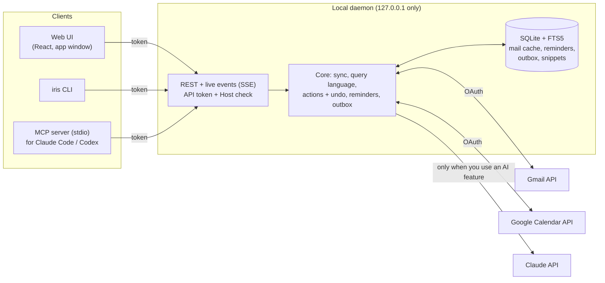
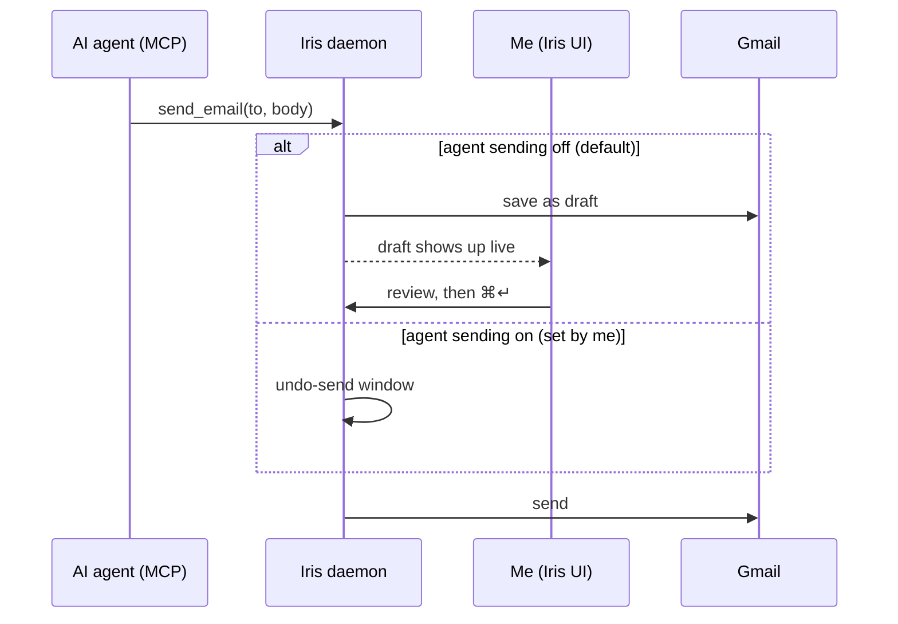

# Iris

A keyboard-first Gmail client for humans and AI agents: one local backend behind a web UI, a CLI and an MCP server.

> **Source is private; this repo is a showcase.** It explains what Iris does, how it works and how it was built. No source code, and no screenshots: Iris runs on my real mailbox, so the diagrams below stand in for them.

Iris is inspired by Superhuman's workflow. I built it after studying how the shipped app behaves, then designed and implemented my own client on top of the Gmail and Google Calendar APIs. It is not affiliated with Superhuman.

## What it does

| Feature | Shortcut | Notes |
|---|---|---|
| Split inbox | `Tab` | Splits are saved Gmail queries (Important, Other, custom). Switching takes under 30 ms. |
| Mark done, undo | `e`, `z` | Every action (done, trash, label, move, mute) can be undone, also across accounts. |
| Command palette | `⌘K` | About 80 keyboard commands, full list on `⌘/`. Vim-style `j`/`k`, `g i` for inbox. |
| Instant search | `/` | Local full-text index (SQLite FTS5) plus Gmail search, Gmail query syntax. |
| Remind me | `h` | Natural language ("fri 3pm", "in 3 days"). Optional "only if nobody replies". |
| Undo send, send later | `⌘↵`, `⌘⇧L` | Outbox with an undo window. `⌘⇧↵` sends and marks done. |
| Snippets | `;` or `⌘;` | Reusable text blocks with variables. |
| Summarize thread | `i` | Claude summary of the open thread. |
| Write with AI | `⌘J` | Draft or rewrite in the composer. |
| Ask your mailbox | `?` | Questions like "when does my flight leave?", answered from your mail with sources. |
| Unsubscribe, block, mute | palette | One-click unsubscribe (RFC 8058), block via Gmail filter. |
| Calendar | `0`, `2` | Google Calendar day pane and week view, natural-language events, RSVP to invites in mail, find free time. |
| Multiple accounts | `⌃1`, `⌃2` | Unified "All Inboxes" plus one mailbox per account. |
| Themes | `⌃T` | Glass (light, default), Carbon (dark), Snow (classic light), or follow the system. |

## Why

Mail is where a lot of real work starts, and AI agents are good at the tedious part of it: triage, finding the one thread, drafting replies. Most agent mail integrations bolt a second, separate path onto Gmail. Iris does the opposite. Humans and agents use the **same backend with the same actions**:

- The **web UI** is for me, keyboard-first.
- The **CLI** (`iris inbox`, `iris search`, `iris remind`, `--json` output) is for scripts and terminal agents.
- The **MCP server** (33 tools: search, read, label, remind, draft, summarize, calendar, undo, ...) lets Claude Code or Codex work the inbox directly.

So when an agent marks 20 newsletters as done, I see it in the UI instantly, and one `z` undoes it.

Sending is the one place humans and agents are treated differently. By default an agent's `send_email` only creates a draft that I review in Iris. Only I can enable agent sending, in the app or from a terminal prompt; an agent cannot grant it to itself. Even then, every agent mail goes through the undo-send window. This is a cooperative safeguard against accidental sends, not a sandbox.

## How it works

A few engineering details that mattered on a real mailbox:

- **Quota-aware sync.** Gmail limits API calls per user per minute. The initial sync fetches metadata only (headers, snippet, labels) and prefetches bodies for the newest inbox threads; everything else loads on open. A rate limiter adapts to quota errors, and anything I trigger jumps ahead of background sync.
- **Resumable.** The initial sync checkpoints every few seconds, so a restart picks up where it left off. After that, Gmail's history API keeps the cache in sync incrementally.
- **Fast splits.** Split inbox queries are parsed once and evaluated in bulk against the local store, which brought switching splits from about 2 s to under 30 ms.

## How it was built

I build by directing AI coding agents. I wrote the specs, broke the work into packages, gave the agents project-specific skills and checked every step with tests and a demo mailbox. **Claude Code and Codex wrote the code.**

- **Specs first.** Before each larger step I wrote a contract the agents implemented against: a UI brief (palette, type, motion rules, icon set), a multi-account contract and a calendar contract.
- **Task breakdown.** Core, daemon, CLI, MCP and UI were built as separate work packages on one shared core, so all three clients get every feature at once.
- **Verification.** About 60 automated tests, including a Gmail REST emulator (token refresh, 401/429 retries, pagination, history sync, threading) and a scripted Claude API (structured output, tool loop, refusals). A deterministic demo mailbox with fictional people runs the whole app without any Google account. Typecheck on every change.
- **Real-mailbox iteration.** Quota limits, lazy bodies and the priority queue came from running it on my own Gmail and fixing what broke.

| | |
|---|---|
| Started | October 2026 |
| Size | ~21,300 lines of TypeScript (incl. ~2,500 lines of tests), ~4,500 lines of CSS |
| Commits | 24 |
| Packages | `core`, `server`, `web`, `cli`, `mcp` (+ macOS app launcher) |

## Tech stack

- **Runtime:** Node 24, TypeScript, npm workspaces
- **Storage:** SQLite (`node:sqlite`) with FTS5 full-text search
- **Daemon:** Hono (REST + Server-Sent Events)
- **UI:** React 19, Vite, installable as a macOS app window / PWA
- **AI:** Claude API (Claude Sonnet) via the Anthropic TypeScript SDK, structured outputs and tool use
- **Agents:** Model Context Protocol SDK (stdio server)
- **Google:** Gmail API, Google Calendar API, OAuth 2.0 (desktop flow)
- **Parsing:** chrono-node for natural-language dates, zod for schemas

## Privacy design

- **Local-first.** Mail is cached on my own machine. It travels only between my Mac and Google. Nothing goes to a server I run, because there is none.
- **AI only on demand.** Mail content goes to the Claude API only when I use an AI feature, with my own API key.
- **Secrets in the OS keychain.** OAuth tokens and the API key live in the macOS Keychain, not in files.
- **Token-gated localhost.** The daemon listens on 127.0.0.1 only, requires a local API token on every request and rejects foreign Host headers to block DNS-rebinding attacks from websites.
- **Tracking pixels blocked.** 1x1 images and known open-tracking URLs never load, and remote images can be blocked entirely. Iris shows how many trackers it blocked in each mail.
- **No read receipts.** They would need a public tracking server, so Iris deliberately leaves them out.

## Contact

Pano · [x.com/panootw](https://x.com/panootw)
